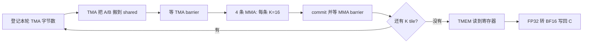

# 从 v1_new 的 PTX 推导 CUTLASS / CuTe 写法

本目录的 BF16 4096 列 softmax 另见 [softmax 代码与实测说明](README_softmax.md)。

[v1.cu](v1.cu) 是 [cuda_kernel/v1_new.cu](../cuda_kernel/v1_new.cu) 的逐指令移植。
原文件不修改。接口仍叫 `mojo_v1`，这样 [原 benchmark](../cuda_kernel/benchmark.cu)
可以原样复用。A 是行主序 `[M,K]`，B 是行主序 `[N,K]`，计算 `C=A*B^T`。
输入/输出 BF16，累加 FP32。

## 先分清 CUTLASS、CuTe 和这次使用的层次

CUTLASS 是 NVIDIA 的 CUDA C++ 模板库。CuTe 是它包含的张量布局与硬件操作组件，
`cutlass/...` 和 `cute/...` 都来自同一个 CUTLASS 仓库。

可以从不同层次使用这套库：直接调用完整 GEMM；用 collective/pipeline 组件组装 GEMM；
或者使用 `cute::SM100_...` 等底层指令封装。为了满足“最小改动”，这里采用第三种。
它将你已有的 PTX 操作表达为 C++ API，保留你原来的调度。
因此这份代码没有引入 `TiledMMA`、`local_tile`、多阶段 pipeline 等新的组织方式。
读懂这份代码，是学习后续 CuTe 布局编程的一个入口。

模板参数 `<...>` 是编译时选项，普通函数参数 `(...)` 是调用时提供的数据。
例如 tile 大小、输入类型提前确定，shared 地址、当前 K 偏移在运行时才确定。
编译器可以据此选择固定指令并展开代码，不需要在 GPU 上运行一个通用解释器。

## 先写下原版的执行顺序，再找对应 API

每个 CTA 有 128 个线程，算一个 `64×256` 的输出块；每轮 K 处理 64 个元素。
shared 仍是 `[A 8192B][B 32768B][TMA barrier 8B][MMA barrier 8B][TMEM 地址 4B][预留 4B]`，
总共 40984B；起点仍按 1024B 对齐。TMEM 仍分配 512 列。



这张图先于任何 API 选择：如果改变它，比如在本轮 MMA 结束前搬下一轮数据，
就是改变算法调度，已经超出此次逐指令替换的范围。

| 原版 PTX 操作 | 新写法 | 为什么选它 |
| --- | --- | --- |
| `mbarrier.init` | `ClusterBarrier::init(ptr, 1)` | 同一个 8B barrier，每轮软件 arrival 数仍为 1 |
| `fence.mbarrier_init.release.cluster` | `fence_barrier_init()` | 保留初始化的可见性要求，后面仍有 CTA 同步 |
| `mbarrier.arrive.expect_tx` | `ClusterTransactionBarrier::arrive_and_expect_tx` | TMA barrier 同时跟踪 arrival 和异步完成字节数 |
| `cp.async.bulk.tensor.2d...` | `SM90_TMA_LOAD_2D::copy` | 原来就是 2D tensor map 搬运；这条 Hopper 指令也适用于 B200 |
| `mbarrier.try_wait.parity` 循环 | `ClusterBarrier::wait(ptr, phase)` | 等待同一个 barrier 的同一个奇偶轮次 |
| `tcgen05.alloc.cta_group::1` | `TMEM::Allocator1Sm::allocate` | 原版是一个 CTA 的 TMEM 分配 |
| `tcgen05.mma.cta_group::1.kind::f16` | `SM100_MMA_F16BF16_SS::fma` | A/B 都在 shared，BF16 输入，FP32 累加 |
| `tcgen05.commit...arrive::one` | `cutlass::arch::umma_arrive` | 将前面异步 MMA 的完成通知交给 MMA barrier |
| `tcgen05.ld...16x256b.x32.b32` | `Copy_Atom<SM100_TMEM_LOAD_16dp256b32x,float>::call` | 保留相同的 TMEM 读指令及寄存器顺序 |
| `tcgen05.wait::ld` | `fence_view_async_tmem_load()` | API 名字含 fence，但实际封装的是 TMEM load 完成等待 |
| `tcgen05.relinquish_alloc_permit` | `release_allocation_lock()` | 交还 TMEM 分配许可 |
| `tcgen05.dealloc` | `allocator.free` | 释放原来分配的 TMEM 列 |
| `tcgen05.fence::after_thread_sync`，两处 | 保留原 PTX | CUTLASS 4.2.1 与 CUDA 12.8 随附 C++ API 都没有封装，保留这两处同步排序指令 |

所有数据搬运、barrier、MMA、TMEM 分配/读取/释放的手写 PTX 均已替换。
仅上述两个 `tcgen05.fence::after_thread_sync` 保留为 `asm`，位置与原版相同；
这是本次替换的明确例外。所用版本缺少封装，为保持 CUDA 12.8 环境及最小改动，
没有额外引入新版 CCCL 依赖。库内部仍然会生成 PTX，封装不意味着换用另一个计算引擎。

## 1. 从 A/B 的数据位置和类型推出 MMA 模板

```cpp
using Mma = cute::SM100_MMA_F16BF16_SS<
    cutlass::bfloat16_t, cutlass::bfloat16_t, float,
    64, 256, cute::UMMA::Major::K, cute::UMMA::Major::K>;
```

按以下问题推导，而不是背这个长名字：

1. GPU 是什么？B200 是 Blackwell SM100，所以查 `SM100` 的 MMA。
2. 输入是什么？A/B 是 BF16，所以选择支持 F16/BF16 的指令族；模板中的两个
   `cutlass::bfloat16_t` 才真正指定 BF16。这里不是因为名字含 F16 就计算 FP16。
3. 结果累加在哪里、是什么类型？累加器在 TMEM 中，数值类型为 `float`。
4. A/B 从哪里读？都在 shared，所以后缀 `SS`。`TS` 则意味着 A 从 TMEM、B 从 shared。
5. 输出 tile 是多少？仍为 `M=64,N=256`。
6. 哪个维度连续？A `[M,K]` 和 B `[N,K]` 都沿 K 连续，因此两个 `Major::K`。
   `Major::K` 描述操作数的布局，不是“两个矩阵都要转置”的意思。

原来每条 MMA 消耗 K=16，而不是整个 BLOCK_K=64，所以仍执行四次 `fma`。
每次 K 偏移 16 个 BF16，也就是 32B。这个固定 K 值由所选硬件指令决定，
不能因为模板里没有显式 K 参数就认为它自动覆盖整个 K。

```cpp
Mma::fma(a_descriptor, b_descriptor, tmem, accumulate, instruction_descriptor);
```

前两个参数是 shared 描述符，第三个是 TMEM 累加器地址。
`accumulate=0` 表示本次覆盖旧累加器，`1` 表示把新乘积加到旧累加器上。
所以只有 `iteration=0,step=0` 为 0，其余全为 1；不必预先清空 TMEM。

底层 `fma` 接口确实还要传 instruction descriptor：
模板给库提供类型与形状约束，但这个 arch 层调用仍显式接收编码。
使用 `make_runtime_instr_desc<同样的类型与形状>()` 生成它，不再手动移位。
该 API 返回 64 位值，高 32 位才是 dense MMA 指令描述符，低 32 位预留给 sparse metadata。
`fma` 内部取高 32 位。这里的 `runtime` 是 API 名称，不代表一定有运行时计算开销；
本例所有选项固定，编译器可以将描述符折叠为常量。

## 2. 区分三种描述符

它们回答不同问题，不能混用：

- `CUtensorMap`：全局内存矩阵在哪里、尺寸和步长是什么、TMA 搬多大、采用什么 swizzle。
  CPU 的 `cuTensorMapEncodeTiled` 生成它。本次保持原版 host 代码。
- `UMMA::SmemDescriptor`：MMA 去 shared 的哪个位置，按什么布局读取。
- `UMMA::InstrDescriptor`：MMA 算什么形状、用什么类型等，与 A/B 地址无关。

`descriptor(address)` 用 `UMMA::SmemDescriptor` 的具名位域替代原来的移位拼接。
`start_address_=address/16`，因为字段以 16B 为单位。
本例 K tile 一行是 `64×2=128B`，128B swizzle 的一个基本布局单元覆盖 8 行，
其跨度为 1024B，所以 `stride_byte_offset_=1024/16=64`。
`layout_type_=SWIZZLE_128B` 必须与 TMA map 的 `CU_TENSOR_MAP_SWIZZLE_128B` 相同。
`version_=1` 保留规范要求的编码；其余字段为 0。

这些数值只对应本例的布局，不是通用描述符公式。
修改 BLOCK_K、swizzle 或操作数主序后，必须重新推导描述符。
此时可以进一步学习 `make_umma_desc` 等从 CuTe shared tensor 布局构造描述符的接口。

## 3. 为什么 barrier 用指针，MMA 用描述符

原版 PTX 接收 `uint32_t` shared 地址；CUTLASS barrier/TMA/allocator API 接收
指向 shared 对象的 C++ 指针，库内部做地址空间转换。

```cpp
auto* tma_barrier = reinterpret_cast<uint64_t*>(shared + A_BYTES + B_BYTES);
```

这是从真实的 shared 指针构造一个 8B 对象的地址。不要写成
`reinterpret_cast<uint64_t*>(shared_base + offset)`：`shared_base` 是 shared 地址空间的数值，
直接强转并不产生正确的 C++ generic 指针。

MMA 的 shared descriptor 仍需要 shared 地址数值，所以保留
`cute::cast_smem_ptr_to_uint(shared)`。两种 API 的参数不同，就分别提供它们所需的表示。

TMA 这次仍搬 `8192+32768=40960B`。`arrive_and_expect_tx(ptr,40960)` 中：
软件 arrival 来自 thread 0；异步 TMA 完成通知扣减事务字节数。都完成才可读取 A/B。
`wait(ptr,phase)` 的 phase 仍从 0 开始每轮异或 1，因为同一个 barrier 被反复使用。

MMA 是异步的，`fma` 返回不代表已算完。`umma_arrive` 提交完成通知，
随后等 MMA barrier 才能覆盖本轮 shared。
`tcgen05.fence::after_thread_sync` 是同步后对后续 tcgen05 操作的排序要求，
不能用 `__syncthreads()` 或 TMEM load 的 wait 随意替代。

线程参与要求不能只按原版的分支照抄。TMA 仍在 thread 0 内调用；TMEM 分配和释放
仍要求第一个 warp 的 32 个线程统一参与；TMEM 读仍由四个 warp 各自执行。

**MMA/commit 的调用分支从 `threadIdx.x==0` 改为 `warp==0`。**
这是逐指令移植里必要的一处控制流调整。CuTe 的这两个封装内部使用
`elect_one_sync`，要求 warp 统一调用，再从中选一个线程实际发出 MMA/commit。
如果仅 thread 0 进入，其他 lane 同时走另一条等待路径，就不满足该封装的使用要求，
实际验证中会挂起。整个 warp 进入后，硬件仍只执行一次所选操作，
不会将同一块矩阵算 32 次；每轮仍是 4 条 MMA 和 1 条 commit。
它也会引入原版没有显式写出的选举指令。

## 4. 从 128 个 PTX 输出操作数推出 Copy_Atom 和 Tensor

原来最冗长的代码是 TMEM 读：一条指令带 128 个输出寄存器。
保持同一条指令需要找到 `16dp256b32x` 的操作，而不是写一个循环读 128 次。

```cpp
float fragment[128];
const uint32_t read_address = tmem + (uint32_t(warp * 32) << 16);
using TmemLoad = cute::SM100_TMEM_LOAD_16dp256b32x;
using TmemLoadTraits = cute::Copy_Traits<TmemLoad>;
auto src_layout = cute::group<0, 2>(cute::upcast<32>(TmemLoadTraits::ValID{}));
auto src = cute::make_tensor(cute::make_tmem_ptr<float>(read_address), src_layout);
auto dst = cute::make_tensor(fragment + 0, cute::make_layout(cute::Int<128>{}));
cute::Copy_Atom<TmemLoad, float>{}.call(src, dst);
```

先理解 Tensor：它是“数据位置 + 从逻辑索引到位置的映射”。这里没有分配新内存。
`make_layout(Int<128>{})` 是一维连续布局，逻辑索引 i 对应数组第 i 项。
`Int<128>` 表示编译时整数，让库在编译时知道有多少输出寄存器。

`make_tmem_ptr<float>(read_address)` 将一个 32 位 TMEM 地址标记为指向 FP32 的 TMEM 指针。
它不是普通的 C++ `float*`：CuTe 由这个类型知道源数据在 TMEM。
`dst` 包着 `fragment` 的 128 个输出值。`fragment + 0` 将 C 数组显式变为
`float*`，避免模板推导将整个 `float[128]` 数组当成迭代器类型；它没有改变地址。

为什么源布局比目的布局复杂？这是 TMEM 指令，有专用的 source layout 要求，
不能把一个地址值包成长度为 1 的普通 tensor 就交给 `Copy_Atom`。
库的 TMEM 专用 `copy_unpack` 会检查源指针确实在 TMEM，源布局也匹配指令。
这能在编译时阻止选择了正确指令却配错布局的问题。

`Copy_Traits<TmemLoad>` 是这条指令的布局说明书，`ValID` 给出整个指令访问范围的
逻辑索引到 TMEM 地址的映射。其原始单位是 bit：
`Shape<8192,16>`，`Stride<1,2^21>`，表示每个 DP 有 8192 bits，共 16 个 DP。
`upcast<32>` 按 32-bit 元素重述它，得到形状 `(256,16)`、步长 `(1,65536)`。
即一维连续 256 个 FP32，另一维跳到下一个 TMEM DP；TMEM 地址的高位编码 DP，
它并非普通二维数组的 row-major 地址。

`group<0,2>` 把两个顶层维度包成一个嵌套维度：`(256,16)` 变为 `((256,16))`。
这样 rank 从 2 变为 1，满足 `.call` 的接口要求，但保留两个维度的地址映射。
它不把 DP 间的大步长改成连续步长，也不产生运行时循环。

`Copy_Atom` 表示一个具体 copy 指令与其数据类型。TMEM 专用 `.call` 最终取出
源 tensor 的 TMEM 起始地址，并将目的 tensor 展开成
`copy(read_address,dst0,...,dst127)` 的引用参数。
源 view 描述一个 warp 的指令覆盖范围 `256×16=4096` 个 FP32；
每线程目的 view 是 128 个值，`32线程×128=4096`，这两者不是同一个维度概念。
无需每个线程再循环读取 4096 个元素。

底层以 `uint32_t` 搬运 32 位原始位模式，`float` 目的 tensor 通过库的 `recast`
匹配它；这是 FP32 位模式的重新解释，不是把浮点数数值转换成整数。

四个 warp 共得到 `128线程×128值=16384=64×256` 个输出。
原来的 TMEM 起点偏移和 fragment 顺序都保留，因此写回循环可以原样沿用。
读指令之后的 `fence_view_async_tmem_load()` 对应 `tcgen05.wait::ld`，
然后 CTA 同步，确保所有线程读完才由 warp 0 释放 TMEM。

这次并没有让 `Copy_Atom` 自动推导整个 CTA 的 C 矩阵布局：
每个 warp 的 TMEM 地址、每个 lane 的 C 坐标仍由原版公式指定。
以后若改用 `make_tmem_copy`、`get_slice`、`partition_*`，才会让 CuTe 管理更多线程到张量的映射。

## 下次自己写时的步骤

1. 列出计算契约：A/B 的物理形状、dtype、连续维度，C 的 dtype 与累加 dtype。
2. 列出每个 tile 的尺寸与生命周期：global → shared → MMA → TMEM → registers → global。
3. 对每个箭头找对应 arch API，检查架构、数据位置、指令形状和线程参与要求。
4. 明确每个参数是指针、地址数值还是描述符；不要通过强转把它们混为一谈。
5. 先保持原有调度和布局，通过正确性与 sanitizer；再检查生成 PTX 和资源占用。
6. 在同一 GPU、同一 benchmark 口径比较。封装能内联，但选举、缓存提示和寄存器分配
   仍可能改变，所以不能仅凭“底层还是同一指令”断言性能完全相同。

可结合固定版本的官方源码阅读：
[MMA 与 fma 接口](https://github.com/NVIDIA/cutlass/blob/v4.2.1/include/cute/arch/mma_sm100_umma.hpp)、
[描述符字段与构造](https://github.com/NVIDIA/cutlass/blob/v4.2.1/include/cute/arch/mma_sm100_desc.hpp)、
[TMEM 分配要求](https://github.com/NVIDIA/cutlass/blob/v4.2.1/include/cute/arch/tmem_allocator_sm100.hpp)、
[Copy_Atom](https://github.com/NVIDIA/cutlass/blob/v4.2.1/include/cute/atom/copy_atom.hpp)、
[copy 参数展开与 recast](https://github.com/NVIDIA/cutlass/blob/v4.2.1/include/cute/atom/copy_traits.hpp)、
[barrier 与 commit](https://github.com/NVIDIA/cutlass/blob/v4.2.1/include/cutlass/arch/barrier.h)。

## B200 benchmark

2026-10-07（北京时间），在同一 NVIDIA B200（148 SM）容器中实测，
CUDA 12.8.1、nvcc 12.8.93、cuBLAS 12.8.4、驱动 580.95.05。
矩阵 `M=N=K=4096`，BF16 输入/输出、FP32 累加。

| 实现 | 三次 run 的中位耗时 | 对应吞吐量 |
| --- | ---: | ---: |
| 原版 PTX `v1_new.cu` | 0.485546 ms | 283.06 TFLOPS |
| CUTLASS/CuTe `v1.cu` | 0.487581 ms | 281.88 TFLOPS |

替换版实测耗时增加 **0.42%**，吞吐量约下降
**0.42%**，性能基本保持。这个差值小于本次轮间波动，
不据此断言存在稳定的性能回退，也不声称耗时完全相同。
这是本次 4096³ 的测量，其他尺寸不由此推断。

三次 run 的中位数（按各自执行顺序，单位 ms）：

| 版本 | 第一次 | 第二次 | 第三次 |
| --- | ---: | ---: | ---: |
| PTX | 0.484980 | 0.485546 | 0.490582 |
| CUTLASS | 0.487581 | 0.484894 | 0.495014 |

21 个轮次样本的范围：PTX 0.484411–0.510934 ms，CUTLASS 0.484521–0.517711 ms。
六次运行各自的 cuBLAS 中位数范围为 0.088613–0.088797 ms。

正确性及检查：

- 两版均通过 `64×256×64`、`128×512×192`、`192×256×512`、`256×768×1024`，
  以及各三次 `4096³` 执行中的正确性检查。
- identity 输入逐元素精确匹配；dense random 与 cuBLAS 输出完全一致，
  `max_abs_error=0`、`relative_l2=0`；每次 32 个 CPU FP64 采样均通过。
- CUTLASS 版在 `128×512×192` 上的 memcheck、synccheck 均 0 errors，
  racecheck 为 0 hazards、0 errors、0 warnings。
- 原版 140 registers，替换版 146 registers；两版都是 0 stack、0 spill stores/loads。
  编译选项未加 `-DNDEBUG`，因此保留 CUTLASS 默认的运行时断言。
- 生成的 PTX 确认 TMEM load 仍是一条 `tcgen05.ld.sync.aligned.16x256b.x32.b32`；
  MMA/TMEM 分配与释放仍采用 `cta_group::1`。封装增加了 `elect.sync`、显式正常 L2 cache hint，
  MMA 的 write-disable mask 显式传 0；编译器生成的循环展开也有差别。
  这些是观察到的代码生成差异，不能单凭总耗时将 0.42% 的差值归因到其中某一项。

[完整结果及日志](results_v1_b200_4096x4096x4096.json)，
[Modal 运行记录](https://modal.com/apps/akseven6221/main/ap-ySia7zPvJwAOcsuJVCqEzL)。
已核对结果中的三份源码 SHA256 与本地文件一致。
下面是固定的比较口径。


[run_v1_modal.py](run_v1_modal.py) 使用 CUDA 12.8.1 镜像与 CUTLASS 4.2.1 的固定 commit
`f3fde58372d33e9a5650ba7b80fc48b3b49d40c8`，两版均用
`nvcc -std=c++17 -O3 -lineinfo -arch=sm_100a`，复用同一个原版 benchmark。

在同一个 B200 容器中，按 PTX/CUTLASS、CUTLASS/PTX、PTX/CUTLASS 三组顺序测量。
每次直接预热 10 次，再预热 CUDA Graph，每个 graph 包含 100 次 GEMM，
CUDA events 计时，custom 与 cuBLAS 交替，共 7 轮，取中位数。
最终每个版本取三次 run 中位数的中位数。
每次执行都重新做 identity、随机输入对照 cuBLAS 和 32 个 CPU FP64 采样检查。

支持范围保持原版要求：正的 M/N/K，且 `M%64=N%256=K%64=0`；没有增加边界处理。

复现：

```bash
.venv/bin/modal run kernel/cutlass_kernel/run_v1_modal.py --sanitize
# 或指定矩阵尺寸
.venv/bin/modal run kernel/cutlass_kernel/run_v1_modal.py --m 1024 --n 1024 --k 1024
```

JSON 保存完整环境、编译资源日志、每轮时间、正确性与 sanitizer 日志、源码 SHA256。
脚本还保存两版生成的 `.sm100a.ptx`，供检查封装后的实际指令。
