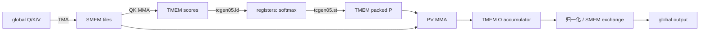

# 基础篇：先理解一行 attention 的状态

[返回路线](README.md) · [开始第 01 课](v01/README.md)

## 1. 从 GEMM 到 attention 多了什么

输入 Q、K、V 都是 `[B,S,H,128]` 的 contiguous FP16。对一个 batch/head：

```text
scores = Q @ Kᵀ / sqrt(128)
P      = softmax(scores, axis=key)
output = P @ V
```

causal 模式只允许 key_position ≤ query_position。直接实现会生成 S×S 的 scores 和 P；这里每次只处理一个 Q tile 与一个 KV tile，把跨 tile 的状态留在寄存器/TMEM 中。

本代码中 `qk()` 得到的是未乘 scale 的点积。softmax 用常量 `s=log2(e)/sqrt(128)≈0.127517430824596` 将指数转为 base 2。下文的 `x`、`r` 都是这个未缩放 score 的单位，别把它们与已经乘 scale 的最大值混用。

## 2. online softmax 的三个状态

固定一个 query 行。已经处理的 keys 集合为 A，以 reference `r` 表示：

```text
l = Σ(k∈A) 2^((x[k]-r)*s)
u = Σ(k∈A) 2^((x[k]-r)*s) * V[k,:]   // 128 个 FP32 元素
```

遇到下一 tile，选择新的 reference `r_new`：

```text
alpha = 2^((r-r_new)*s)
p[k]  = 2^((x[k]-r_new)*s)
l_new = alpha*l + Σ p[k]
u_new = alpha*u + p @ V_tile
output = u / l                         // 所有 KV tiles 结束后才归一化
```

首轮显式令 alpha=0，并让 PV 不累加旧 O，避免读取未初始化状态。代码的 `rowmax` 对应 r，`rowsum` 对应 l，TMEM 中的 O 对应未归一化 u。

第 04 课开始，reference 不必每次都更新为真实最大值；只要 P 保持数值可表示，且 l/u 以相同 reference 更新，数学比值不变。实现仍有近似 exponent、FP16 P 和浮点累加误差，必须按容差验证。

**手算练习**：两个单元素 tiles 的自然指数 logits 是 0、ln(2)，V 分别为 10、20。第一块状态为 l=1、u=10；第二块以 ln(2) 为 reference 时 alpha=1/2，新状态 l=1.5、u=25，输出 16.666…，与完整 softmax 的 (10+2×20)/3 相同。若只缩放 l、不缩放 u，就会出错。

## 3. 几种存储各负责什么

| 位置 | 内容 | 主要访问者 | 读代码时要关注 |
| --- | --- | --- | --- |
| global memory | Q/K/V 和最终 output | TMA、输出 stores | BSHD strides、边界与合并访问 |
| shared memory / SMEM | swizzled Q/K/V tiles、barriers、epilogue staging | TMA、MMA、普通线程 | 生命周期、swizzle、异步可见性 |
| tensor memory / TMEM | FP32 S/O、packed FP16 P | Tensor Core 与 tcgen05.ld/st | 别名区域、谁拥有读写权、释放时刻 |
| registers | 每线程一行 scores、reference、rowsum、临时 reduction | software softmax | live range、依赖链、spill |

`TILE_BYTES=128*128*2=32768`。v1 的 Q/K/V 数据占 96 KiB SMEM；v7 的两份 Q 与两组 K/V 数据占 192 KiB，另加 metadata。读到 SHARED_BYTES 时，要区分 tile 数据与 barrier/staging 的额外空间。



## 4. lane 的工作不等于物理地址连续

本系列常见布局是一个 software 线程负责一个 query row，持有 128 个 scores。它让 softmax 无需跨线程归约，但最终 global store 时，相邻 lanes 的输出行相距 `H*D` 个元素。第 03 课用 SMEM exchange 改变输出 ownership。

v1 使用 256 TMEM columns：S 在 [0,128)，O 在 [128,256)，P 打包后覆盖 S 的前 64 列。双 Q-stage 路径使用 512 columns：S0/S1 各 128 列、O0/O1 各 128 列，P 覆盖对应 S 的高 64 列。这里的地址不是普通 global pointer：`warp*32 << 16` 选择 datapath 部分，低位偏移表示列。不要照搬普通线性 byte offset 的算术。

先读 `attention()` 中的数据流，再回头查 `ld128/st64/qk/pv` helper。长长的 inline asm 寄存器参数列表用于传递 fragment，不是每课都要逐项背诵的算法。

## 5. 同步要分开回答三个问题

1. 操作是否已发出？执行 `qk()`/`pv()`/TMA 发射代码只回答这个问题。
2. 操作是否已完成？MMA 使用 commit 配合 mbarrier completion；线程的 TMEM load/store 使用对应 wait。
3. 完成后的数据是否按协议交给另一角色？跨线程交接还要看 release/acquire 和 tcgen05 fence。

这些概念依据 [NVIDIA PTX 的 tcgen05 memory consistency 章节](https://docs.nvidia.com/cuda/parallel-thread-execution/index.html#tcgen05-memory-consistency-model)。具体到本仓库的 producer/consumer 关系见 [SYNCHRONIZATION.md](../SYNCHRONIZATION.md)。

在最终双 Q-stage 路径中，用以下表逐个核对 barrier：

| 名称 | 它代表的事件 | 不能误解成 |
| --- | --- | --- |
| KFULL/VFULL | 当前 slot 的 TMA 数据 ready | 旧 slot 已经没人读 |
| KEMPTY/VEMPTY | 最后一个旧 MMA consumer 已完成 | producer 已经开始覆盖就可以了 |
| SFULL | QK 及被 commit 跟踪的先前 MMA 完成 | 只有 QK 指令已发射 |
| PFULL | software 已发布 P 和必要的 O correction | exp2 算完就万事大吉 |
| FINAL | 最终 MMA drain 完成 | 某个 software WG 已退出循环 |
| EPIDONE | 所有 epilogue TMEM 读取结束 | 任意一个输出线程结束 |

一个 slot 的 `phase` 是该 barrier 的完成代次，不是整个 kernel 的全局轮号。双 slot 时 j=0,1 属于两个不同 barrier 的 phase0，j=2,3 才各进入 phase1。future parity 不是“预约等待未来轮次”的通用机制，第 08 课会看到真实错误。

第 17 课只删除特定的 MMA 顺序依赖：同 warp、同 cta_group 的 MMA A/metadata 读取先于后续 MMA D 写入。这个特例不适用于所有异步指令，更不自动跨越不同 warp。[PTX pipelined tcgen05 规则](https://docs.nvidia.com/cuda/parallel-thread-execution/index.html#tcgen05-pipelined-instructions)

## 6. 不要把三个性能概念混为一谈

| 概念 | 含义 | 本教程的例子 |
| --- | --- | --- |
| 理论 occupancy | 资源限制下最多能驻留多少 CTA/warp | v39 资源允许更多 CTA，但不代表它们持续有可执行工作 |
| achieved active warps / TC active | NCU 在实际运行中观察到的活动指标 | v39 active warps 约 6，v27 的 TC active 比 v24 高 |
| 端到端 latency | 完成同一 attention 的时间 | 由 CUDA Graph 交替计时获得；用它决定是否采用改动 |

`官方吞吐百分比 = 官方时间 / 自写时间 * 100%`，不是 SM 理论峰值利用率。NCU replay 会影响 cache 和执行状态，不能拿 NCU duration 代替 benchmark 排名。读取 profile 时先提出假设，再用同机计时检验。

每课下一步都遵循：读父版 → 写出本次要改变的依赖/地址/资源 → 阅读 diff → 检查正确性边界 → 看配对性能。这个顺序比先背一串优化名称更有帮助。
