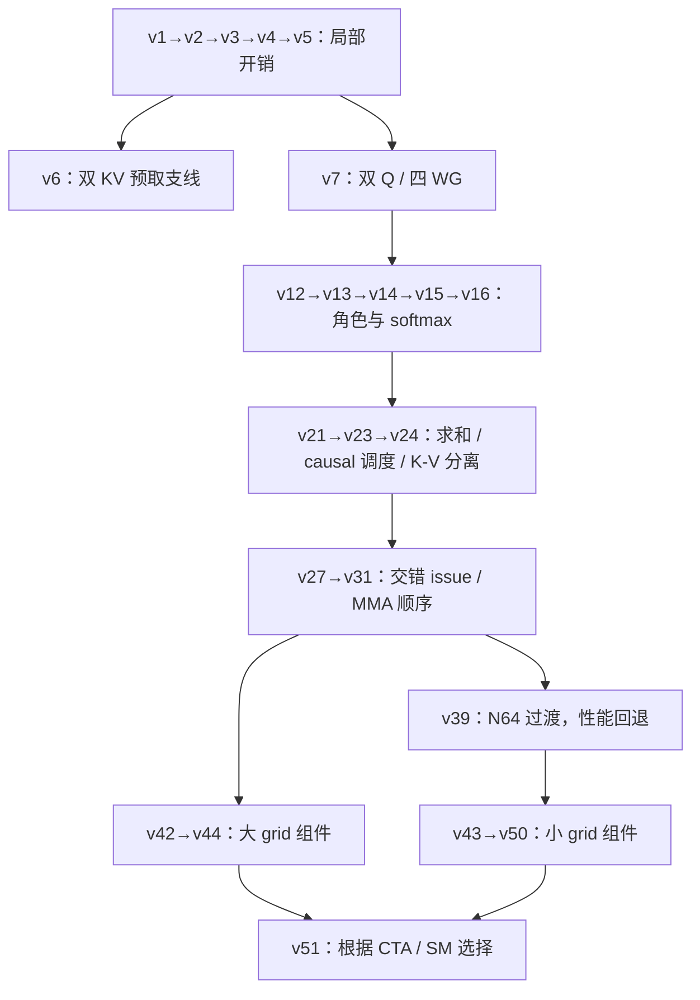

# 从串行 attention 到 v51：CUDA + PTX 学习路线

这套教程把 51 个实验整理成 **23 个阅读版本**。从一个可运行但慢的串行实现开始，先消除多余指令和低效写回，再学习流水线、资源分配、同步证明，最后把长序列与小任务两条路径合成 v51。

`tutorial/v01` 表示第 1 课，`../v1` 表示原实验 v1。每课明确列出两者映射和真实父版本；例如第 8 课对应原 v12，而不是原 v8。所有课都提供：

- 带中文关键位置导读的完整 `kernel.cu`。
- 瓶颈 → 改法 → 正确性约束 → profile 证据 → 性能取舍的说明。
- 相对真实父版的 `.diff`，以及含原始计时样本、误差、源码哈希的 `evidence.json`。
- 一道动手推导题、参考答案和原实验复现命令。

教学源码只插入 `// [教程]` 注释。去掉这些行后，与对应的已测实验源码逐字节相同。原目录、原始运行和 profile 保持独立，教程的说明可通过 [build.py](build.py) 重建和核验。

## 从哪里开始

先读 [基础篇：公式、存储与同步](FOUNDATIONS.md)，随后按下面四个阶段阅读。熟悉 CUDA GEMM 也建议先看 attention 的 online 状态更新：这里两次 GEMM 中间夹着 softmax，不能直接照搬 GEMM 的流水线。

| 阶段 | 课号 | 学习目标 | 学完应能解释 |
| --- | --- | --- | --- |
| 串行基线与局部开销 | 01–06 | 指数、合并写回、rescale、reciprocal、KV 预取 | 为什么已用 Tensor Core 仍然很慢 |
| 架构与 software softmax | 07–15 | 双 Q-stage、角色合并、mask、FMA、ILP、寄存器、causal remap、K/V 生命周期 | 为什么资源、数值与同步必须一起考虑 |
| 大 grid 调度 | 16–19 | QK/PV 交错、删除已证明冗余的等待、packed FP32、模式专门化 | 为什么相同计算的 issue 顺序会改变吞吐 |
| 小 grid 与最终组合 | 20–23 | N64 反例、单 Q-stage、bank conflict、shape dispatch | 为什么最终实现需要两条路径 |

如果只想先抓住关键收益，可以读 **01 → 03 → 05 → 07 → 08 → 09 → 14 → 15 → 16 → 17 → 21 → 23**，再回补其余课。源码继承关系仍以下图和每课父版本为准。

## 实际代码如何演进

下图使用**原实验版本号**；上面的课号只负责阅读顺序。



v6 是有价值的预取支线，v7 的真实父版是 v5。v39 是用来解释小 grid 设计的失败性能假设，v43 从它继续调整。v14、v16 等步骤保留在真实祖先链里，但最终数据并不支持“每一步都更快”。本教程从低性能走向最终实现，同时展示这些判断过程。

## 全部课程与实测数据

表中 B=1、H=8、D=128、FP16。**R1** 是 `final_all_versions`；**R2** 是 `r2_final_all`。同课的父子对比全部取自同一个 run；不要用跨 R1/R2 的相邻行计算 speedup。每课给出父版/本版比例，完整 8 个 shapes 保存在其 `evidence.json`。

<!-- ROUTE_TABLE_START -->

| 课号 | 原实验 | 本课主题 | 真实父版本 | 数据轮次 | S512 非 causal μs | S8192 非 causal μs | S8192 causal μs |
| --- | --- | --- | --- | --- | ---: | ---: | ---: |
| [v01](v01/README.md) | [v1](../v1/README.md) | 跑通串行 attention：先理解数据流 | — | R1 | 31.84 | 829.22 | 612.06 |
| [v02](v02/README.md) | [v2](../v2/README.md) | 指数指令：exp2f → ex2.approx | v1 | R1 | 30.41 | 760.10 | 525.33 |
| [v03](v03/README.md) | [v3](../v3/README.md) | 合并写回：用 SMEM 转换线程到输出的映射 | v2 | R1 | 19.25 | 693.45 | 480.94 |
| [v04](v04/README.md) | [v4](../v4/README.md) | 减少 O 重缩放：延迟更新 reference | v3 | R1 | 19.15 | 688.29 | 462.55 |
| [v05](v05/README.md) | [v5](../v5/README.md) | 归一化：一行一次 reciprocal | v4 | R1 | 15.67 | 680.17 | 445.97 |
| [v06](v06/README.md) | [v6](../v6/README.md) | 预取支线：双 K/V buffer | v5 | R1 | 14.64 | 580.06 | 379.70 |
| [v07](v07/README.md) | [v7](../v7/README.md) | 架构过渡：双 Q-stage 与四个 warpgroup | v5 | R1 | 23.24 | 451.90 | 400.25 |
| [v08](v08/README.md) | [v12](../v12/README.md) | 合并角色：softmax owner 自己修正 O | v7 | R1 | 20.07 | 446.26 | 400.47 |
| [v09](v09/README.md) | [v13](../v13/README.md) | mask fast path：完整 tile 不逐元素检查 | v12 | R1 | 18.22 | 386.84 | 307.26 |
| [v10](v10/README.md) | [v14](../v14/README.md) | FMA 与数值稳定性：减少指令不保证更快 | v13 | R1 | 19.14 | 407.38 | 323.16 |
| [v11](v11/README.md) | [v15](../v15/README.md) | max reduction：四条独立依赖链 | v14 | R1 | 18.53 | 384.30 | 308.85 |
| [v12](v12/README.md) | [v16](../v16/README.md) | 寄存器预算：为 software owner 分配资源 | v15 | R1 | 18.54 | 383.25 | 310.19 |
| [v13](v13/README.md) | [v21](../v21/README.md) | rowsum reduction：四条 pair-sum 链 | v16 | R1 | 17.81 | 365.18 | 290.46 |
| [v14](v14/README.md) | [v23](../v23/README.md) | causal 负载均衡：先安排较重的 query tiles | v21 | R1 | 16.88 | 369.35 | 185.14 |
| [v15](v15/README.md) | [v24](../v24/README.md) | 拆开 K/V 生命周期：尽早释放 K | v23 | R1 | 16.78 | 360.95 | 181.64 |
| [v16](v16/README.md) | [v27](../v27/README.md) | 交错 QK/PV：让另一个 stage 填补等待 | v24 | R2 | 15.57 | 291.58 | 147.35 |
| [v17](v17/README.md) | [v31](../v31/README.md) | 消除多余等待：先证明 MMA 的读写顺序 | v27 | R2 | 15.25 | 278.87 | 142.71 |
| [v18](v18/README.md) | [v42](../v42/README.md) | packed FP32：同时减少指令与依赖 | v31 | R2 | 14.69 | 274.30 | 142.44 |
| [v19](v19/README.md) | [v44](../v44/README.md) | 按模式专门化：causal 与 non-causal 分开选择 | v42 | R2 | 14.72 | 275.56 | 141.89 |
| [v20](v20/README.md) | [v39](../v39/README.md) | 小任务支线：更高理论 occupancy 为什么仍慢 | v31 | R2 | 14.79 | 643.01 | 312.68 |
| [v21](v21/README.md) | [v43](../v43/README.md) | 小 grid 专用：恢复 N128，保留单 Q-stage | v39 | R2 | 12.13 | 479.98 | 238.50 |
| [v22](v22/README.md) | [v50](../v50/README.md) | 修正 epilogue bank conflict：130 half → 129 half | v43 | R2 | 12.03 | 484.78 | 241.07 |
| [v23](v23/README.md) | [v51](../v51/README.md) | 汇合：按 CTA/SM 数选择完整 kernel | v44+v50 | R2 | 12.04 | 276.08 | 142.61 |

<!-- ROUTE_TABLE_END -->

## 最终学到了什么

局部优化先减少不必要工作；流水线优化再利用独立工作覆盖等待；资源分配决定这些工作是否能驻留；同步协议保证 overlap 后仍正确。最后用实际 CTA 数区分小任务和大任务，而不是把版本号最大的 kernel 用到所有 shape。

第二轮同机测得，S8192 non-causal 的原 v1 为 837.00 μs、v51 为 276.08 μs，约 3.03×；causal 为 627.40→142.61 μs，约 4.40×。v51 仍只达到对应官方 FA4 吞吐的约 74%；S512 non-causal 约 89%。这些是保存的测量，未宣称达到全局最优。详见 [第二轮报告](../OPTIMIZATION_ROUND2.md)。

继续阅读：

- [实验操作：怎样复测、改一个点、保存证据](LAB.md)
- [支线与反例：其余 28 个实验为什么不放在主课里](EXPERIMENTS.md)
- [完整同步协议与修正历史](../SYNCHRONIZATION.md)
- [教程映射与源码哈希](manifest.json)

在仓库根目录验证教程：

```bash
.venv/bin/python kernel/fa4/tutorial/build.py --check
```

本次是对已测实现的教学整理，没有重新运行 GPU。性能范围为 B200、contiguous BSHD、FP16 输入/输出、FP32 累加、D=128、dense self-attention forward，支持 causal/non-causal；其他 dtype、维度、backward、GQA、varlen 不属于本教程的已验证范围。
